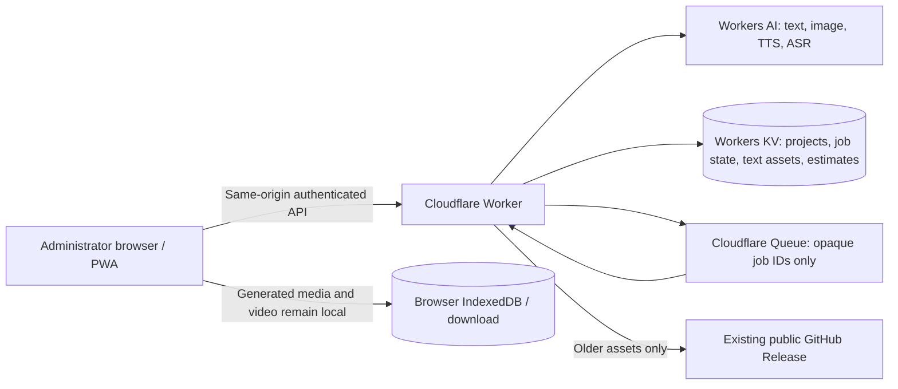

# CatchiMediaStudio

**A private, browser-first creative workspace for real text, image and speech generation, with transparent free-tier guardrails.** The app targets Cloudflare Workers Free and Workers AI. “Zero cost” is conditional on the account remaining eligible for free allocations; the product does not promise unlimited generation and never silently switches to a paid provider.

## Product capabilities

| Capability | Implementation | Honest boundary |
|---|---|---|
| Text and campaign copy | Background Cloudflare Queue job → Workers AI `@cf/meta/llama-3.1-8b-instruct-fp8` | A job is labelled successful only when the real model response is stored. Free allowance or queue exhaustion produces a clear failure. |
| Image generation | Workers AI `@cf/black-forest-labs/flux-1-schnell` | Returns the actual validated JPEG/PNG/WebP bytes; prompt, steps and optional seed are supported. Generated files stay in browser storage and can be downloaded. |
| Narration | Workers AI `@cf/myshell-ai/melotts` | Actual MP3 output; English and French are exposed. The model integration does not expose a selectable voice ID. |
| Transcription | Workers AI `@cf/openai/whisper` | Actual transcript from bounded audio upload (512 KiB maximum); result is editable text. |
| Video planning | Text Studio script and storyboard workflows | Text planning only; never described as video footage. |
| Video synthesis | Not enabled | No verified no-charge text-to-video provider is configured. |
| Video file assembly | Browser Canvas + `MediaRecorder` | Creates a real WebM from user-selected stills, optional soundtrack and captions on the user's device. Browser, codec, memory and duration limits apply. |
| Projects and templates | Private Worker API backed by Cloudflare KV | One administrator; no public registration or multi-tenant claims. |
| Installable/offline shell | PWA manifest, icons and static-only service worker | The cached shell does not make cloud sign-in, private records or generation available offline. |

## Architecture



Static app files are gzip-compressed into the reproducible Worker bundle. The live Worker uses its API routes for same-origin private operations, and static responses include CSP and browser security headers. The browser service worker caches only the public application shell: it deliberately never caches `/api/*` or `/asset/*` responses.

## Privacy and retention

- Project metadata, prompts, bounded job results, text assets, and transcripts use the configured Cloudflare KV namespace.
- New generated image/audio bytes and browser-assembled videos are retained in browser IndexedDB only when browser storage succeeds; they are not uploaded to GitHub or Cloudflare object storage. Download important files.
- Queue messages contain opaque job IDs—not prompts or media—and Cloudflare Free queue retention is 24 hours. Job metadata/results have their own bounded KV retention.
- Previous release assets were not migrated or deleted. This repository is public, so legacy GitHub Release URLs may also be public. The old asset lifecycle deletion automation has been replaced with a read-only audit.
- Existing Groq/Hugging Face secret bindings are not used by the new generation routes. They are not used as fallbacks and no secret values are committed.

## Zero-cost guardrails and constraints

- Workers AI is the only configured inference provider. Application-side requests are capped conservatively (3,000 estimated neurons/day, 50 text jobs/day); the estimate is **not** Cloudflare billing or account-wide usage telemetry, and concurrent KV counter updates are not atomic.
- Cloudflare Workers Free currently has request, CPU and storage limits; Workers AI's free allocation is finite (10,000 neurons/day in the verified documentation). Queues and KV also have daily free-tier limits. Calls can fail when any allocation is exhausted.
- No paid fallback is enabled. Do not raise the application caps or add third-party providers without separately reviewing eligibility, pricing, privacy and account-wide usage.
- There is no Cloudflare R2/D1/paid compute dependency. Media generation depends on real account access to the documented Workers AI models; catalog presence alone does not prove a live inference.

## Repository map

```text
src/index.js                 Worker API router, authentication boundary and static fallback
src/lib/common.js            bounded parsing, HMAC session and conservative KV estimate helpers
src/lib/projects.js          project and prompt-template operations
src/lib/jobs.js              idempotent queued text jobs and retry/dead-letter state
src/lib/media.js             image/TTS/ASR provider contracts and asset metadata
public/                      responsive PWA interface, browser studios and offline shell
scripts/build.mjs            deterministic gzip-embedded Worker build and safety checks
tests/                       Worker, provider, auth, budget and bundled-static tests
wrangler.toml                Cloudflare AI/KV/Queue bindings
.github/workflows/ci.yml     read-only PR/push tests, audit and Wrangler dry run
.github/workflows/deploy.yml manual main-branch deploy with an explicit choice and smoke tests
docs/RESEARCH.md             dated official model/limit sources and design implications
docs/SETUP.md                account secrets and guarded deployment setup
docs/SECURITY.md             threat boundaries, data handling and known limitations
```

## Developer checks

Requires Node.js 22. `npm ci`, `npm test`, `npm audit --audit-level=high`, and `npx wrangler deploy --dry-run --outdir .wrangler/dry-run` are the standard validation path. `npm test` builds the static bundle and runs the offline Worker suite. The production workflow is manual-only; pushes do **not** automatically publish.

See [setup and deployment](docs/SETUP.md), [security and privacy](docs/SECURITY.md), and [verified platform research](docs/RESEARCH.md).
